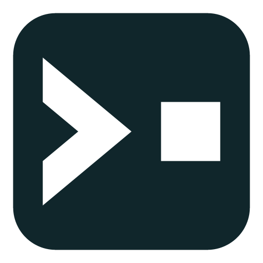

<p align="center">
	<a href="https://rogen-roblox.vercel.app">
		<picture>
			<source media="(prefers-color-scheme: dark)" srcset="docs/public/icon.png" />
			
		</picture>
	</a>
</p>
<h1 align="center">Rogen</h1>
<p align="center">
	<strong>Rojo with file-system routing. Professional-grade architecture for Roblox codebases.</strong>
</p>
<p align="center">
	Rogen is a superset of Rojo that generates Rojo project files from your file system. Put code in a <code>Server</code> or <code>Client</code> folder, or add <code>@Server</code> to a file's name, and Rogen sends it to the right place.
</p>
<p align="center">
	<a href="https://www.npmjs.com/package/@ldgerrits/rogen"></a>
	<a href="https://rogen-roblox.vercel.app/docs/v2"></a>
	<a href="https://discord.com/channels/385151591524597761/1503801029232295996"></a>
	<a href="https://github.com/LDGerrits/rogen/stargazers"></a>
	<a href="https://luau.org"></a>
	<a href="https://roblox-ts.com"></a>
</p>

## Why Rogen?

- **Organize by feature** — Group all code, UI, and assets for a specific feature in one place. This gives you high cohesion, better scalability, fewer merge conflicts, and features that are simple to maintain or delete.
- **Enforce boundaries** — Keep coupling low with a linter. Every path names its feature, so a [lint rule](https://rogen-roblox.vercel.app/docs/v2/architectures) can stop one feature from requiring another.
- **Multi-place games** — Write shared code once and use it in every place. When one place needs something different, add a file with the same name to that place's folder, and it overwrites the shared one there.
- **Still Rojo** — Rogen runs the Rojo commands you use, with the same flags. One tool, and nothing to relearn.

## Built for agents

When an agent works on a feature, everything it needs is in one folder, from server to client. It spends its context on your task instead of searching the codebase.

Running several agents? Give each one a feature. A lint rule catches any agent that makes one feature require another, and there's no shared project file to conflict on.

## Example

`default.rogen.json` is a Rojo project file with `routes` added. The `tree` is the base: put in it what folder names can't say, such as your packages, and Rogen adds every routed file to it:

<!-- prettier-ignore -->
```json
{
  "name": "my-game",
  "routes": {
    "Server": "ServerScriptService",
    "Client": "StarterPlayer/StarterPlayerScripts",
    "Shared": "ReplicatedStorage/Shared",
    "*": "ReplicatedStorage/Shared"
  },
  "tree": {
    "$className": "DataModel",
    "ReplicatedStorage": {
      "Packages": { "$path": "Packages" }
    }
  }
}
```

A folder or an `@` suffix named after a route sends its code there. The `*` route takes every file that matches no other:

| In `src/Inventory`                | Goes to                                        |
| --------------------------------- | ---------------------------------------------- |
| `Server/InventoryService.luau`    | `ServerScriptService/Inventory`                |
| `Client/InventoryController.luau` | `StarterPlayer/StarterPlayerScripts/Inventory` |
| `Shared/InventoryTypes.luau`      | `ReplicatedStorage/Shared/Inventory`           |
| `Save@Server.luau`                | `ServerScriptService/Inventory`                |
| `InventoryConfig.luau`            | `ReplicatedStorage/Shared/Inventory`           |

The routes are yours to change. Add `"Gui": "StarterGui"`, and a `Gui` folder or a `@Gui` suffix sends code to StarterGui.

## Installation

```bash
rokit add ldgerrits/rogen@2.0.0-beta.1
rogen init
```

`rogen init` pins Rojo in `rokit.toml` and tells you to run `rokit install` to fetch it. New to Rojo? Also run `rogen plugin install` to add its Studio plugin. Prefer npm? Run `npm i @ldgerrits/rogen@next` and use `npx rogen`.

## Usage

```bash
rogen serve                # Serve with Rojo and update the project file on changes
rogen build -o game.rbxl   # Update the project file, then build a place with Rojo
rogen check                # Print warnings and errors, and exit 1 on any
```

`sourcemap`, `upload`, `syncback` and `plugin` take Rojo's flags too. See the [documentation](https://rogen-roblox.vercel.app/docs/v2) for every command.

## FAQ

#### Does Rogen replace Rojo?

Yes and no. You run `rogen` instead of `rojo`, but Rojo still does the syncing and building underneath. Its Studio plugin stays installed too.

#### Does Rogen work with Argon?

Yes, for syncing your files into Studio. Run `rogen write --watch` and serve with Argon. To bring Studio changes back, save the place and run `rogen syncback --input game.rbxl`. With Rojo, it's one command: `rogen serve` keeps the project file current and serves it.

#### Can I use Rogen in an existing Rojo project?

Yes. Run `rogen init` to move it to Rogen. See [Coming from Rojo](https://rogen-roblox.vercel.app/docs/v2/coming-from-rojo).

## Contributing

Read the [contributing guide](CONTRIBUTING.md) before you open a pull request. You can also star the repo or [sponsor its development](https://github.com/sponsors/LDGerrits).

## License

Rogen is [MIT licensed](LICENSE.md).
